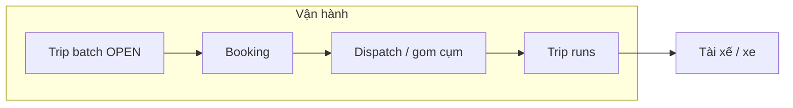
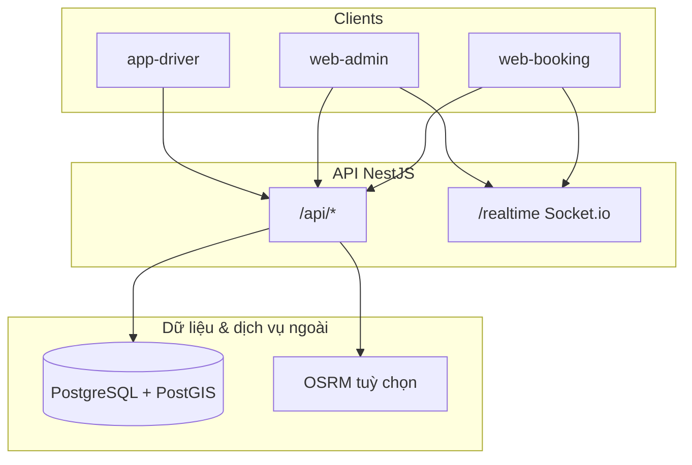

# NovaLimo — Hệ thống quản lý xe limousine

Monorepo **[Nx](https://nx.dev)** gom backend API (**NestJS**), web đặt vé & quản trị (**Next.js**), app tài xế (**Expo**) và thư viện dùng chung trong một mã nguồn — thống nhất kiểu dữ liệu, dễ kiểm thử và triển khai.

Tài liệu này giúp **khách hàng / đối tác / đội vận hành** nắm **nghiệp vụ**, **cấu trúc hệ thống** và **cách cấu hình đúng** để tránh lỗi kết nối, sai môi trường hoặc rủi ro dữ liệu.

---

## Ý nghĩa sử dụng sản phẩm

**NovaLimo** hướng tới **doanh nghiệp vận tải hành khách cao cấp (xe limousine, xe dịch vụ theo lô chuyến)** cần một nền tảng **số hóa và thống nhất** thay vì phân mảnh giữa gọi điện, chat, bảng tính và nhiều công cụ rời.

- **Với hành khách / người đặt chỗ:** đặt vé theo **lô chuyến** (tuyến, khung giờ), khai báo **điểm đón – điểm trả** và ghế (nếu được cấu hình), giảm nhầm lẫn địa chỉ và giảm tải tổng đài so với đặt hoàn toàn thủ công.
- **Với điều hành và quản trị:** quản lý **lô chuyến**, **booking**, **gom cụm – điều phối** xe và tài xế, theo dõi trạng thái chuyến trên **một luồng dữ liệu** thay vì nhiều phiên bản thông tin khác nhau.
- **Với tài xế:** dùng **ứng dụng trên điện thoại** để nhận chuyến được gán, cập nhật tiến độ (và vị trí khi hệ thống hỗ trợ), gắn chặt với backend thay vì chỉ dựa tin nhắn hay cuộc gọi rời.

**Giá trị cốt lõi:** một **chuỗi nghiệp vụ khép kín** — từ đặt vé → điều phối → chạy xe — trên **một nguồn dữ liệu**, hướng tới **ít sai sót, ít trùng lặp** giữa kênh bán, điều hành và tài xế.

---

## Các ứng dụng trong project (`apps/`)

Trong monorepo, thư mục **`apps/`** chứa **bốn project** (mỗi cái là một “app” hoặc service có thể build/chạy riêng trong Nx):

| Thư mục (tên project Nx) | Công nghệ           | Đối tượng sử dụng                   | Vai trò                                                                                                                                                                               |
| ------------------------ | ------------------- | ----------------------------------- | ------------------------------------------------------------------------------------------------------------------------------------------------------------------------------------- |
| **`api-server`**         | NestJS              | Hệ thống, các client, tích hợp khác | **Backend API:** REST (prefix `/api`), **Socket.io** realtime, nghiệp vụ lõi, database, xác thực — **không** phải màn hình người dùng, nhưng là **trung tâm** mọi ứng dụng phía dưới. |
| **`web-booking`**        | Next.js             | Khách / người đặt vé                | **Ứng dụng web đặt vé:** chọn lô chuyến, đặt chỗ, điểm đón/trả, ghế (nếu có).                                                                                                         |
| **`web-admin`**          | Next.js             | Điều hành, quản trị viên            | **Ứng dụng web quản trị:** lô chuyến, booking, điều phối, theo dõi vận hành.                                                                                                          |
| **`app-driver`**         | Expo (React Native) | Tài xế                              | **Ứng dụng mobile (iOS/Android):** ca làm việc, chuyến được gán, cập nhật trạng thái / vị trí (theo tính năng hiện có trong code).                                                    |

**Tóm lại:** **ba app giao diện người dùng** (`web-booking`, `web-admin`, `app-driver`) + **một backend** (`api-server`). Các thư viện dùng chung nằm ở **`libs/`** (kiểu dữ liệu, tiện ích bản đồ, UI chung, …).

---

## 1. Tổng quan thành phần kỹ thuật (API, CSDL, OSRM)

| Thành phần               | Vai trò                                                                                                                                    |
| ------------------------ | ------------------------------------------------------------------------------------------------------------------------------------------ |
| **API (`api-server`)**   | Nghiệp vụ lõi: lô chuyến, đặt vé, điều phối, chuyến chạy, xe, người dùng, hàng hóa (cargo), geocode; xác thực JWT; realtime **Socket.io**. |
| **PostgreSQL + PostGIS** | Lưu trữ; trường địa lý (geom) phục vụ khoảng cách và **gom cụm điều phối** (`DISPATCH_CLUSTER_MODE=postgres`).                             |
| **OSRM** (tuỳ chọn)      | Ma trận khoảng cách / tuyến đường thực tế; nếu không có, hệ thống có thể dùng tính toán thay thế (ví dụ Haversine) tùy luồng code.         |

**Hai kênh giao tiếp cần phân biệt:**

- **REST:** mọi client dùng một **base URL** kết thúc bằng **`/api`** (Nest `globalPrefix`).
- **Realtime:** Socket.io gắn với **origin HTTP** (cùng host với API), đường dẫn **`/realtime`** — **không** nằm dưới `/api`.

Chi tiết biến môi trường và kiểm tra: **`.env.example`**, **`docs/INTEGRATION_VERIFICATION.md`**.

---

## 2. Mô hình nghiệp vụ (domain)

Các khái niệm chính trong codebase hiện tại:

### 2.1. Lô chuyến (trip batch)

Một **lô** gom nhiều booking cùng tuyến / khung giờ khởi hành.

| Trạng thái    | Ý nghĩa gợi ý                                                         |
| ------------- | --------------------------------------------------------------------- |
| **OPEN**      | Cho phép **đặt vé** và (khi đủ điều kiện) chạy **điều phối** gom cụm. |
| **CLUSTERED** | Đã qua bước gom cụm / gán chuyến (theo luồng nghiệp vụ).              |
| **COMPLETED** | Kết thúc lô.                                                          |

Đặt vé chỉ hợp lệ khi lô đang **OPEN** (API từ chối nếu khác).

### 2.2. Đặt vé (booking)

- Gắn với **một `trip_batch_id`**, có điểm đón/trả (địa chỉ + **lat/lng**), thông tin hành khách, ghế (`seat_label`) tuỳ cấu hình.
- Trạng thái hành trình ví dụ: **WAITING** → **PICKED_UP** → **DROPPED_OFF** (hoặc **CANCELLED**).
- **Ghế:** nếu chọn ghế, hệ thống chống trùng trong cùng lô cho các trạng thái đang hiệu lực (theo `bookings.service`).
- Sau khi lưu, hệ thống **đồng bộ PostGIS** (`pickup_geom` / `dropoff_geom`) từ tọa độ — cần **PostGIS** để đầy đủ tính năng không gian.

### 2.3. Điều phối (dispatch)

- Gom cụm điểm đón (ví dụ bán kính **`DISPATCH_CLUSTER_EPS_M`** mét), có chế độ **`postgres`** (PostGIS) hoặc **`kmeans`** (JS) — xem cấu hình API.
- Cần **xe AVAILABLE**, **tài xế ACTIVE**, và **có booking** trong lô; lô phải **OPEN** khi cluster (theo `dispatch.service`).

### 2.4. Chuyến chạy (trip run)

Một **trip run** gán **xe + tài xế** cho phần việc trong lô; trạng thái ví dụ: **PENDING** → **IN_PROGRESS** → **FINISHED**.

### 2.5. Tài nguyên khác

- **Xe:** biển số, sức chứa, trạng thái (AVAILABLE / MAINTENANCE / IN_USE).
- **Người dùng:** vai trò **ADMIN** hoặc **DRIVER**, SĐT unique.
- **Ca tài xế (`driver_shifts`):** thời điểm bắt đầu / kết thúc ca.
- **Cargo / hàng:** vận đơn (`waybill_code` unique), gắn chuyến khi có.

### 2.6. Luồng nghiệp vụ tóm tắt



---

## 3. Kiến trúc & cấu trúc project

### 3.1. Sơ đồ logic



### 3.2. Thư mục chính

```
apps/
  api-server/     # NestJS — REST + Socket + TypeORM
  web-booking/    # Next.js — khách đặt vé
  web-admin/      # Next.js — quản trị
  app-driver/     # Expo — tài xế
libs/
  shared-types/   # Kiểu dữ liệu dùng chung (domain/API)
  utils-core/     # Tiện ích (ví dụ suy ra origin socket từ API URL)
  utils-map/      # Hỗ trợ bản đồ / không gian (theo module hiện có)
  shared-ui/      # UI dùng chung (nếu có)
tools/            # Script (verify tích hợp, dữ liệu OSRM, …)
docs/             # Tài liệu kỹ thuật bổ sung
```

### 3.3. Monorepo Nx

- Một workspace quản lý nhiều **project**; dependency giữa thư viện và app được khai báo rõ.
- Xem đồ thị phụ thuộc: `npx nx graph`.

---

## 4. Cấu hình đúng — tránh “hỏng” kết nối và sai môi trường

### 4.1. Một bảng “một sự thật” cho URL

| Biến / chỗ dùng             | Ai đọc                | Ghi chú quan trọng                                                                                              |
| --------------------------- | --------------------- | --------------------------------------------------------------------------------------------------------------- |
| **`DATABASE_URL`**          | API                   | Phải trỏ đúng host/port/DB/user — **sai là mất hoặc ghi nhầm DB**.                                              |
| **`NEXT_PUBLIC_API_URL`**   | Next (booking, admin) | Embed **lúc build** — đổi URL API cần **build lại** hoặc restart dev với env mới.                               |
| **`EXPO_PUBLIC_API_URL`**   | Expo app-driver       | Tương tự build-time; **Android emulator** thường dùng `http://10.0.2.2:3000/api` thay cho `localhost`.          |
| **`PORT`**                  | API                   | Mặc định 3000; **phải khớp** phần host trong `NEXT_PUBLIC_API_URL` (ví dụ cùng cổng 3000).                      |
| **`JWT_SECRET`**            | API                   | Đổi secret làm **token cũ vô hiệu** — cần đăng nhập lại; production **không** dùng giá trị mẫu.                 |
| **`OSRM_BASE_URL`**         | API (routing)         | OSRM không chạy hoặc URL sai → ma trận khoảng cách / dispatch có thể lỗi hoặc lệ thuộc fallback (kiểm tra log). |
| **`DISPATCH_CLUSTER_MODE`** | API                   | `postgres` cần **PostGIS** và geom hợp lệ; `kmeans` là đường khác, không cần PostGIS cho bước cluster đó.       |

### 4.2. Cổng dịch vụ (dev)

- API: **`http://localhost:3000`**, REST: **`http://localhost:3000/api`**.
- Next.js mặc định cũng hay dùng cổng **3000** → nếu chạy **API + Next cùng máy**, phải tách cổng (ví dụ Next `3001`) để **không tranh cổng**.
- `NEXT_PUBLIC_API_URL` vẫn trỏ tới API (**3000**), không trỏ nhầm sang cổng Next.

### 4.3. Production vs development (dữ liệu & schema)

- Trong **development**, TypeORM có thể **`synchronize`** schema (xem `database.module`) — **tiện** nhưng **không** coi là an toàn cho production.
- **`NODE_ENV=production`**: `synchronize` tắt — **bắt buộc** quy trình **migration** có kiểm soát, backup DB trước khi đổi schema.
- **Không** trỏ ứng dụng production vào database dev/staging nhầm — rủi ro **ghi đè / lẫn dữ liệu**.

### 4.4. Seed dữ liệu mẫu

- Seed chạy khi **bảng trống** (xe, user, trip batch) — **không** xóa dữ liệu sẵn có.
- Trên môi trường đã có dữ liệu thật, **đừng** phụ thuộc seed để “sửa” DB; dùng quy trình migration / import có kiểm soát.

---

## 5. Yêu cầu môi trường

- **Node.js** (khuyến nghị LTS, ví dụ 20.x) và **npm**
- **Docker** — chạy PostgreSQL/PostGIS (và OSRM nếu dùng)
- Windows: nếu Nx lỗi cache, thử `set NX_DAEMON=false` rồi chạy lại

---

## 6. Cài đặt nhanh

```bash
git clone <repository-url>
cd NovaLimo
npm install
copy .env.example .env
```

Chỉnh `.env` theo môi trường (đặc biệt production: **JWT**, **DATABASE_URL**, URL public).

---

## 7. Chạy database & OSRM

**PostgreSQL + PostGIS:**

```bash
docker compose up -d
```

| Thông số mặc định | Giá trị    |
| ----------------- | ---------- |
| User / database   | `novalimo` |
| Mật khẩu          | `novalimo` |
| Cổng              | `5432`     |

**OSRM (tuỳ chọn):** chuẩn bị file `.osrm` trong `tools/osrm-data/`, sau đó:

```bash
docker compose --profile osrm up -d
```

(`OSRM_BASE_URL` mặc định `http://localhost:5000`.)

### Đóng gói & chạy bằng Docker (API + Next — booking & admin)

Có thể **build image** cho backend và cả hai web Next trong Docker, rồi dựng cùng PostgreSQL bằng Compose (file **`docker-compose.stack.yml`** + **`docker-compose.yml`**).

| File                       | Vai trò                                                                                           |
| -------------------------- | ------------------------------------------------------------------------------------------------- |
| `docker/Dockerfile.api`    | Multi-stage: `npm ci` → `nx build api-server` → image chạy `node main.js` (cổng 3000).            |
| `docker/Dockerfile.next`   | Build-arg `NX_APP` = `web-booking` hoặc `web-admin`; dùng **`output: 'standalone'`** của Next.js. |
| `docker-compose.stack.yml` | Service `api`, `web-booking`, `web-admin` nối với `postgres` từ compose gốc.                      |
| `.dockerignore`            | Giảm context build (bỏ `node_modules`, `.next`, …).                                               |

**Chạy full stack (cần Docker Desktop / Engine):**

```bash
npm run docker:stack
```

Tương đương:

```bash
docker compose -f docker-compose.yml -f docker-compose.stack.yml up --build
```

**Cổng mặc định sau khi lên:**

| Dịch vụ      | URL                         |
| ------------ | --------------------------- |
| API          | `http://localhost:3000/api` |
| Web đặt vé   | `http://localhost:3001`     |
| Web quản trị | `http://localhost:3002`     |

**Lưu ý quan trọng:** `NEXT_PUBLIC_API_URL` được **nhúng lúc build** image Next. Giá trị mặc định là `http://localhost:3000/api` (trình duyệt trên máy bạn gọi API qua localhost). Khi deploy ra **domain / HTTPS**, cần build lại image với biến môi trường (ví dụ file `.env` cùng thư mục compose: `NEXT_PUBLIC_API_URL=https://api.cua-ban.com/api`). API trong stack dùng `DATABASE_URL` trỏ tới service Docker `postgres`.

Chi tiết thêm: **`docker/README.md`**.

**App tài xế (Expo)** không nằm trong stack Docker này; vẫn build bằng Nx/Expo riêng (store hoặc OTA).

---

## 8. Chạy ứng dụng (development)

| Lệnh                         | Mục đích                               |
| ---------------------------- | -------------------------------------- |
| `npm run dev:api`            | API                                    |
| `npm run dev:booking`        | Web đặt vé                             |
| `npm run dev:admin`          | Web quản trị                           |
| `npm run dev:all`            | API + web-admin + web-booking          |
| `npm run build:all`          | Build các project có target build      |
| `npm run lint:all`           | Lint workspace                         |
| `npm run verify:integration` | Kiểm tra tích hợp (API phải đang chạy) |

**Gợi ý:** API cổng 3000; Next chạy cổng khác, ví dụ:

```bash
cd apps/web-booking
npx next dev -p 3001
```

**Expo:** `npx nx start app-driver` (hoặc target tương đương trong project).

---

## 9. Dữ liệu mẫu sau khi cài

Khi DB **trống**, API khởi động sẽ **seed** xe, user demo, một lô chuyến (`seed.service.ts`).

- Ví dụ tài xế: SĐT `0900000001` … — mật khẩu demo (ví dụ `demo`).
- Admin trong seed có thể có ràng buộc đặc biệt (ví dụ `password_hash` null) — kiểm tra luồng đăng nhập admin thực tế.

---

## 10. Kiểm tra & tài liệu thêm

1. `docker compose ps` — DB sống.
2. `npm run dev:api` — API lên.
3. `GET http://localhost:3000/api` — phản hồi API (theo `app.controller`).
4. `npm run verify:integration` — smoke tích hợp.

- **`docs/INTEGRATION_VERIFICATION.md`** — checklist REST, Socket, biến môi trường.
- **`/.env.example`** — danh sách biến và ý nghĩa.

```bash
npx nx graph
```

---

## 11. Khám phá Nx

Workspace dùng [Nx](https://nx.dev) để cache task, quản lý phụ thuộc và scale CI.

---

_Tài liệu phản ánh kiến trúc và nghiệp vụ trong mã nguồn hiện tại. Triển khai production cần thêm: HTTPS, backup định kỳ, giám sát, phân quyền vận hành và quy trình thay đổi schema có kiểm soát._

---

## Giấy phép (License)

Dự án **phi thương mại**, phát hành theo giấy phép **[Creative Commons Attribution-NonCommercial 4.0 International (CC BY-NC 4.0)](https://creativecommons.org/licenses/by-nc/4.0/)** — xem toàn văn tại [`LICENSE`](LICENSE).

- ✅ Được **sao chép, chia sẻ, chỉnh sửa** và phát triển tiếp mã nguồn.
- ✅ Phải **ghi nguồn** (tên dự án NovaLimo, tác giả, link repo) và nêu rõ nếu có thay đổi.
- ❌ **Không được sử dụng cho mục đích thương mại.**

Muốn sử dụng cho mục đích thương mại, vui lòng liên hệ tác giả qua GitHub.
