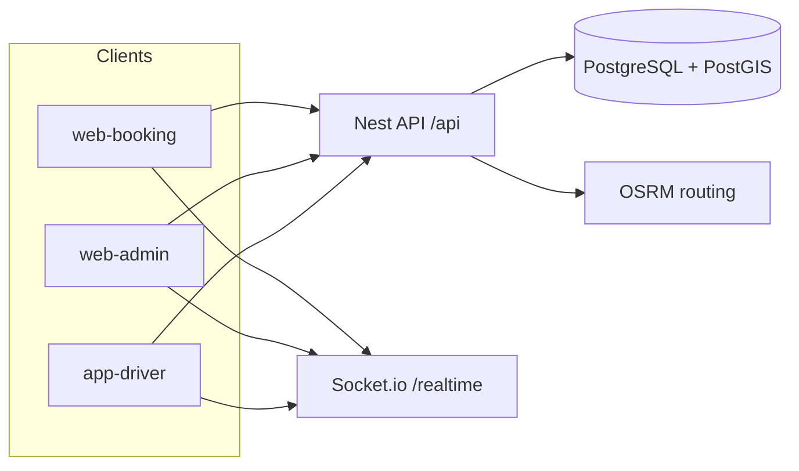

# Đặc tả tổng thể và cấu hình hệ thống NovaLimo

*Tài liệu **điểm vào** cho toàn bộ đặc tả phân hệ: cách đọc, vận hành tài liệu song song với code, và **mẫu cấu hình** đủ khỏe để dùng ở nhiều môi trường / nhiều client mà không phân mảnh “mỗi nơi một kiểu”.*

---

## 1. Vai trò của tài liệu này so với ba đặc tả phân hệ

| Tài liệu chi tiết | Đối tượng đọc chính | File thiết kế (Pencil) | Mã nguồn chính |
|-------------------|---------------------|-------------------------|----------------|
| [WEB SITE ĐẶT VÉ.md](./WEB%20SITE%20ĐẶT%20VÉ.md) | Product, UX, frontend booking | `web-bôking.pen` | `apps/web-booking` |
| [Đặc Tả Hệ Thống Web Admin…](./Đặc%20Tả%20Hệ%20Thống%20Web%20Admin%20Quản%20Trị%20Và%20Điều%20Hành%20NovaLimo.md) | Điều hành, CS, kế toán cấu hình | `web-admin.pen` | `apps/web-admin` |
| [TÀI LIỆU ĐẶC TẢ PHÂN HỆ - MOBILE APP (DÀNH CHO TÀI XẾ).md](./TÀI%20LIỆU%20ĐẶC%20TẢ%20PHÂN%20HỆ%20-%20MOBILE%20APP%20(DÀNH%20CHO%20TÀI%20XẾ).md) | Tài xế (IA/UX), mobile dev | `app-mobile.pen`, `app-mobile-chat-shift.pen` | `apps/app-driver` |

**Luật vàng:** Nghiệp vụ “một sự thật” nằm ở **API + database** (`apps/api-server`). Ba client chỉ là **giao diện và luồng**; đặc tả phân hệ mô tả **trải nghiệm và ràng buộc hiển thị**, không thay cho hợp đồng API hay schema DB.

---

## 2. Sơ đồ phân hệ (logical)

- **REST:** mọi client dùng **cùng một chuẩn** base URL kết thúc bằng `/api` (global prefix Nest).
- **Realtime:** Socket.io **không** gắn dưới `/api`; client suy ra origin từ base API (bỏ hậu tố `/api`) và nối kênh realtime — đã ghi trong `.env.example` ở root repo.

---

## 3. Cách dùng tài liệu tối ưu (quy trình gợi ý)

1. **Thay đổi màn hình / luồng:** sửa **Pencil** trước hoặc song song → cập nhật đúng **tên frame** trong file `.md` tương ứng → mở ticket/dev map **route** (Next/React Navigation).
2. **Thay đổi nghiệp vụ sâu (vé, chuyến, COD):** cập nhật **API + shared-types** trước → sau đó chỉnh 1–3 đặc tả client để khớp trải nghiệm.
3. **Tra cứu nhanh “ai làm gì”:**  
   - Khách đặt vé / cargo công khai → **WEB SITE ĐẶT VÉ**.  
   - Điều phối, báo cáo, RBAC → **Web Admin**.  
   - Tài xế đường trường → **Mobile App**.

4. **Giữ phiên bản tài liệu:** trong commit/PR, ghi rõ *cập nhật đặc tả [tên file] vì [lý do]* để sau này audit được.

---

## 4. Nguyên tắc cấu hình cho hệ thống lớn (mẫu tham chiếu)

Các mẫu dưới đây bám **The Twelve-Factor App** và thực tế monorepo NovaLimo (một `package.json` gốc, nhiều app).

### 4.1. Phân tầng cấu hình (config hierarchy)

| Tầng | Nội dung | Ví dụ |
|------|----------|--------|
| **Mặc định an toàn** | Giá trị dev local, không bí mật | `PORT=3000`, URL OSRM nội bộ |
| **Biến môi trường** | Khác nhau theo staging/production | `DATABASE_URL`, `JWT_SECRET`, `NEXT_PUBLIC_API_URL` |
| **Bí mật** | Không commit; chỉ secret manager / CI | Khóa JWT, connection string production |
| **Cấu hình nghiệp vụ trong DB** | Thay đổi không cần redeploy code | Giá vé, khung giờ, mẫu SMS — khớp các màn “Cấu hình …” trong Web Admin |

**Không** nhúng URL production hay khóa vào source; luôn đọc từ env hoặc dịch vụ cấu hình.

### 4.2. Một “sự thật” cho URL API và realtime

Trong repo, `.env.example` đã mô tả:

- `NEXT_PUBLIC_API_URL` / `EXPO_PUBLIC_API_URL` trỏ tới `http(s)://host:port/api`.
- Socket: **origin không có `/api`**, ví dụ kết nối tới `${origin}/realtime` — tránh lỗi lặp đường dẫn khi thêm client mới (web thứ ba, mini-app, v.v.).

Khi thêm **client thứ N**, chỉ cần:

1. Cùng quy ước biến `*_API_URL` (kết thúc `/api`).
2. Hàm tiện ích chung (đã gợi ý trong comment `.env.example`: `getSocketOriginFromApiBaseUrl`) để không copy-paste chuỗi sai.

### 4.3. Ma trận biến môi trường (mở rộng từ `.env.example`)

| Nhóm | Biến / khu vực | Ghi chú vận hành |
|------|----------------|------------------|
| **API & DB** | `DATABASE_URL`, `TYPEORM_*`, `JWT_SECRET` | Production: tắt `synchronize`; dùng migration. |
| **Điều phối** | `DISPATCH_CLUSTER_MODE`, `DISPATCH_CLUSTER_EPS_M`, `OSRM_BASE_URL` | Tuning theo mật độ điểm đón; OSRM có thể scale riêng. |
| **Web** | `NEXT_PUBLIC_API_URL`, tùy chọn `NEXT_PUBLIC_GOOGLE_MAPS_API_KEY` | Prefix `NEXT_PUBLIC_` chỉ cho dữ liệu **không nhạy cảm** (public). |
| **Mobile** | `EXPO_PUBLIC_API_URL` | Emulator Android dùng `10.0.2.2` thay `localhost`. |

Thêm môi trường **staging** bằng cách duplicate bộ biến với host/secret riêng — không fork logic trong code.

### 4.4. Feature flags (khi hệ thống lớn dần)

- **Giai đoạn đầu:** bật/tắt tính năng bằng biến env (đơn giản).  
- **Giai đoạn sau:** bảng `feature_flags` hoặc dịch vụ config; Admin đọc quyền RBAC + flag để hiển thị menu (khớp các màn RBAC trong `web-admin.pen`).

Ghi chép trong đặc tả: *tính năng X phụ thuộc flag Y* để không “tài liệu có mà production tắt” gây hiểu nhầm.

### 4.5. Đa vùng / đa thương hiệu (tuỳ roadmap)

Nếu sau này nhiều nhà xe dùng chung nền:

- **Tenant** = `tenant_id` trên các bảng nghiệp vụ + JWT claim.  
- **Branding:** `NEXT_PUBLIC_BRAND_*` hoặc CMS; tài liệu đặt vé nên tách “copy cố định” vs “copy cấu hình”.

Hiện tài liệu NovaLimo đơn thương hiệu — chỉ cần nhận thức điểm mở rộng này khi thiết kế API.

### 4.6. RBAC và bề mặt API

- **Web Admin:** màn RBAC trong pen map với roles/permissions trên server — mọi endpoint nhạy cảm kiểm tra guard, không chỉ ẩn menu.  
- **Driver / Booking:** JWT phân tách **driver** vs **customer/admin** (đã có hướng trong kiến trúc API). Đặc tả client chỉ mô tả **được phép thấy gì**; enforcement ở API.

### 4.7. Quan sát & vận hành (production)

- **Logging:** request id, `user_id`/`driver_id` trên log quan trọng.  
- **Metrics:** latency điều phối, lỗi thanh toán, tỷ lệ socket disconnect.  
- **Health:** `/health` cho API, DB, OSRM (tuỳ triển khai).

Không cần nhét hết vào đặc tả phân hệ từng client — nhưng **một trang runbook** nội bộ (ngoài thư mục `New/` nếu muốn) nên tham chiếu các biến mục 4.3.

---

## 5. Chuẩn truy vết: từ thiết kế → route → API

Để hệ lớn không “lệch bản vẽ”:

| Bước | Output |
|------|--------|
| Frame trong `.pen` | Tên chuẩn (đã có trong các file `.md`) |
| Bảng mapping code | **[Bảng Mapping Route Code ↔ Màn Thiết Kế](./Bảng%20Mapping%20Route%20Code%20%E2%86%94%20M%C3%A0n%20Thi%E1%BA%BFt%20K%E1%BA%BF.md)** — route Next.js / màn React Navigation ↔ frame Pencil, kèm trạng thái Đã có / Một phần / Chưa có |
| Issue / wiki nội bộ | Bổ sung `Frame → API chính` khi cần chi tiết hợp đồng |
| Code | Route Next/Expo; gọi `libs` api client dùng `*_API_URL` |

Ví dụ luồng chung: `TripBatch` mở trên Admin (điều phối) ↔ cùng entity driver nhận trên app ↔ khách thấy trạng thái vé trên booking — **một bảng / một API**, ba cách hiển thị.

---

## 6. Checklist trước khi merge thay đổi lớn

- [ ] Đã cập nhật đặc tả phân hệ tương ứng (nếu đổi UX có tên frame).  
- [ ] Đã kiểm tra env mới có trong `.env.example` + mô tả ý nghĩa.  
- [ ] API và `shared-types` đồng bộ; client không tự thêm field “chữa cháy”.  
- [ ] Realtime: kiểm tra origin socket sau khi đổi domain.

---

## 7. Tài liệu liên quan trong repo

- `docs/api-surface.md` (nếu duy trì) — bề mặt REST.  
- `.env.example` — nguồn sự thật cho biến môi trường mẫu.  
- `README.md` gốc — cách chạy stack.

---

*Tài liệu này bổ sung cho ba đặc tả phân hệ; khi mâu thuẫn giữa “mô tả UX” và “hành vi API thực tế”, ưu tiên **API + DB** rồi chỉnh lại đặc tả hoặc backlog sửa product.*
